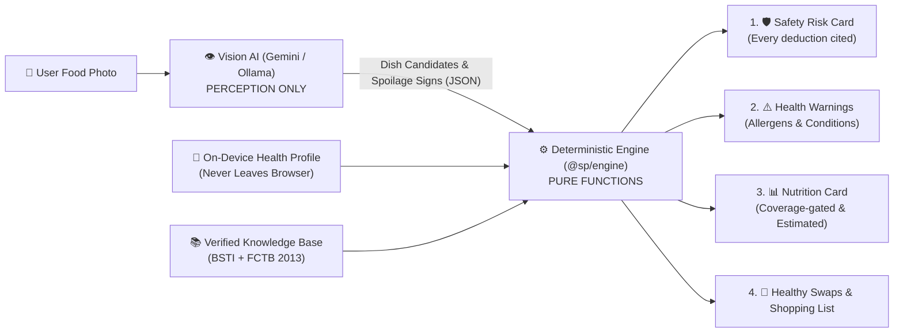

# SafePlate 🍽️🛡️

[](https://www.typescriptlang.org/)
[](https://react.dev/)
[](https://vitejs.dev/)
[](https://tailwindcss.com/)
[](https://modelcontextprotocol.io/)
[](https://pages.cloudflare.com/)
[](https://github.com/syeedur-01/SafePlate/actions/workflows/ci.yml)

> **"AI perceives. Deterministic code decides."**  
> SafePlate is a bilingual (English / বাংলা) food intelligence web application built for the **International AI Builders Congress 2026**. Users photograph a cooked dish or a packaged-food label to receive transparent safety scoring, on-device health warnings, honest nutritional estimates, and clinically safer swap recommendations.

🌐 **Live Application:** [https://safeplate-czd.pages.dev](https://safeplate-czd.pages.dev)  
📦 **Repository:** [https://github.com/syeedur-01/SafePlate](https://github.com/syeedur-01/SafePlate)

---

## 💡 The Core Philosophy

In healthcare and food safety, **LLMs must never hallucinate risks, thresholds, or clinical guidance**. SafePlate enforces an architectural separation between AI vision perception and deterministic decision logic:



- **The AI only reads the photo:** Identifies candidate dishes, detects visual spoilage indicators (mold, slime, bubbles), or transcribes packaging labels.
- **Tested deterministic code decides:** All safety risk scores, warning severities, FCTB nutrient tallies, and swap calculations are computed by pure, tested TypeScript functions.

---

## ✨ Key Features

- **🛡️ Evidence-Linked Safety Score (0–100):** Every point deducted links directly to Bangladesh Standards and Testing Institution (BSTI), Codex Alimentarius, or microbial growth limits. It never gives a false "100% safe" guarantee.
- **🔒 Zero-Knowledge Health Profile:** Chronic conditions (hypertension, diabetes, high cholesterol, gastric) and allergies (milk, peanut, gluten, fish, etc.) **never leave your device**. The API request schema is `.strict()` and rejects health profiles.
- **📊 Honest Nutritional Coverage:** Nutritional values are compiled from the **Food Composition Table for Bangladesh (FCTB 2013)** and USDA databases. Dishes with $< 80\%$ energy coverage automatically gate individual numbers.
- **🔄 Culturally Authentic Swaps:** Suggests alternative traditional Bangladeshi dishes that lower sodium, fat, or sugar by at least 20%.
- **🇧🇩 Deep Bangla Localization:** Built from the ground up with bilingual support (বাংলা & English). Custom Unicode tokenization preserves Bangla combining vowel marks (_kar_ and _fola_) during allergen keyword matching.
- **🤖 Model Context Protocol (MCP) Server:** Features a built-in MCP server (`@sp/mcp`) exposing SafePlate's deterministic engine and knowledge base over `stdio` to **Claude Desktop**, **Cursor IDE**, and **Google Antigravity**.

---

## 🚀 Quick Start (Local Development)

### Prerequisites

- **Node.js:** $\ge 20$
- **pnpm:** $\ge 9$ (pnpm 12 supported)

```bash
# 1. Clone the repository
git clone https://github.com/syeedur-01/SafePlate.git
cd SafePlate

# 2. Install dependencies across all monorepo packages
pnpm install

# 3. Start the Web App (Vite + React)
pnpm --filter @sp/web dev

# 4. Start the API Server (Hono on Node)
pnpm --filter @sp/api dev

# 5. Run the built-in MCP Server
pnpm mcp
```

### Run Verification & Tests

```bash
# Full check: TypeScript typecheck + ESLint + Prettier check + All Vitest suites (~350+ tests)
pnpm check
```

---

## 📱 Interactive Offline Demo (No API Quota Needed)

You do **not** need an API key, camera, or network connection to inspect SafePlate:

1. Open the web app and navigate to **Demo Scenarios** at `/demo` (or click _"Demo Scenarios (offline)"_ on the Scan page).
2. Choose from 4 scripted real-world scenarios:
   - 🍛 **Kacchi Biryani:** High-calorie, high-sodium rich celebration meal triggering hypertension warnings and lower-sodium pitha swaps.
   - 🐟 **Panta Ilish:** Traditional fermented rice and hilsa fish evaluating fermentation tags, sodium, and histamine safety rules.
   - 🍲 **Street Food Snack (Jhalmuri):** Street vendor context checking raw ingredient and temperature safety triggers.
   - 📦 **Packaged Biscuit Label:** OCR label scan detecting hidden milk derivatives, high sodium, and trans fat.
3. Each demo scenario executes the **exact production deterministic engine** in-memory.

---

## 🤖 Model Context Protocol (MCP) Integration

SafePlate includes a production-ready MCP server in `packages/mcp`. External AI agents (Claude Desktop, Cursor, Antigravity) can connect via `stdio` to query deterministic food safety and nutrition intelligence:

```bash
# Start the MCP server
pnpm mcp
# or: pnpm --filter @sp/mcp start
```

### Exposed Endpoints

| Type         | Endpoint                      | Description                                                                                               |
| :----------- | :---------------------------- | :-------------------------------------------------------------------------------------------------------- |
| **Tool**     | `safeplate_assess_safety`     | Evaluates food safety risk score (0–100) using BSTI thresholds and spoilage signals                       |
| **Tool**     | `safeplate_lookup_nutrition`  | Queries FCTB 2013 and USDA databases for verified macro/micronutrients per portion                        |
| **Tool**     | `safeplate_check_suitability` | Evaluates medical suitability against chronic conditions and 10 allergens                                 |
| **Tool**     | `safeplate_suggest_swaps`     | Recommends culturally authentic, clinically safer alternative dishes ($\ge 20\%$ lower flagged nutrients) |
| **Tool**     | `safeplate_analyze_label`     | Parses packaging text for red-flag additives, high sodium/sugar/fat, and undeclared allergens             |
| **Tool**     | `safeplate_list_dishes`       | Lists and searches the 30 validated Bangladeshi dishes in the knowledge base                              |
| **Resource** | `safeplate://dishes`          | Full JSON catalogue of 30 Bangladeshi dishes with ingredient ratios                                       |
| **Resource** | `safeplate://safety-rules`    | Active BSTI and Codex food safety thresholds                                                              |
| **Resource** | `safeplate://health-rules`    | Clinical condition and allergen dietary threshold rules                                                   |
| **Resource** | `safeplate://allergens`       | Bilingual allergen vocabulary mapping English and Bangla keywords                                         |

Full MCP setup documentation and configuration snippets are available in [`docs/MCP_SERVER.md`](docs/MCP_SERVER.md).

---

## 🏛️ Monorepo Architecture

SafePlate is organized as a strict, modular pnpm monorepo:

```
SafePlate/
├── apps/
│   ├── web/               # Vite + React 18 + Tailwind CSS + Framer Motion PWA
│   └── api/               # Hono web standards API (Cloudflare Worker & Node entry)
├── packages/
│   ├── contracts/         # Zod schemas, TypeScript types, and test builders
│   ├── engine/            # Pure functions: safety, nutrition, suitability, swaps, label analysis
│   ├── knowledge/         # Normalized dishes, FCTB tables, BSTI rules, bilingual strings
│   ├── ai/                # Vision providers (Gemini, Ollama), prompts, JSON parsing & cache
│   └── mcp/               # Model Context Protocol (MCP) stdio server
├── tools/                 # Data pipelines: PDF table extractor, USDA matcher, eval benchmark
└── docs/                  # Technical design, benchmark evaluation reports, audit reports
```

### Package Summary

| Package         | Purpose                       | Strict Rule                                                                      |
| :-------------- | :---------------------------- | :------------------------------------------------------------------------------- |
| `@sp/contracts` | Shared Zod schemas & types    | Immutable without formal contract change                                         |
| `@sp/engine`    | Deterministic calculations    | Pure functions only: no `Date.now()`, no `Math.random()`, no I/O, no LLM calls   |
| `@sp/knowledge` | Food composition & rule data  | Data source register with record-level provenance; "Proposals are not approvals" |
| `@sp/ai`        | Visual perception adapter     | Prompt-level schema constraints; strict Zod response parsing                     |
| `@sp/mcp`       | Model Context Protocol server | Exposes pure engine tools over `stdio` to AI desktop clients                     |
| `@sp/api`       | API Gateway                   | Rejects health profile payloads; zero persistent photo storage                   |
| `@sp/web`       | Responsive client application | Responsive down to 360px; accessible WCAG contrast; on-device profile storage    |

---

## 🔬 Benchmark & Evaluation

SafePlate includes a reproducible evaluation harness (`tools/src/eval-run.ts`) tested against 263 scorable images from the CC0 **BD-Food33** dataset across 8 approved Bangladeshi dishes:

- **Cloud Primary:** `gemini-3.5-flash-lite` serves as the primary production vision model.
- **On-Device Local Audit:** We benchmarked `Qwen2.5-VL-3B-Instruct` locally via **Ollama (0.40.16)** on an **NVIDIA GeForce RTX 4060 GPU** (4-bit quantization, 100% GPU offload, 2.8 GB VRAM). While fast (3,763 ms median latency), its 44.5% top-1 accuracy produced confident misclassifications on safety-critical dishes, validating our decision to retain Cloud Gemini for live production while offering local models for offline development.

Read the full report in [`docs/MODEL_COMPARISON.md`](docs/MODEL_COMPARISON.md) and [`docs/EVAL_REPORT.md`](docs/EVAL_REPORT.md).

---

## 🔒 Privacy & Safety Standards

1. **On-Device Profile:** Health conditions, dietary restrictions, and allergy records are stored exclusively in client-side `localStorage`. They are never transmitted over the network or logged.
2. **Ephemeral Memory Processing:** Uploaded food photographs are analyzed in memory and immediately discarded. Photos are never stored on disk or database.
3. **Null is Not Zero:** If a nutrient was not measured in primary literature (FCTB / USDA), it remains `null`—never assumed to be `0`.
4. **Mandatory Chemical Disclaimer:** SafePlate explicitly states on every result that visual analysis cannot detect invisible microbial toxins, pesticide residues, or heavy metals (`notice.chemical_limit`).

---

## 📄 License & Attribution

- **Software:** MIT License
- **Food Data:** Sourced with attribution from the _Food Composition Table for Bangladesh (FCTB 2013)_, _Indian Food Composition Tables (IFCT 2017)_, and _USDA FoodData Central_.
- **Benchmark Images:** CC0 Public Domain via BD-Food33.
